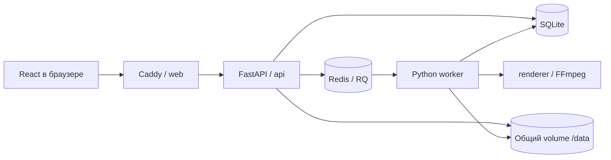

# Архитектура

Схема целевая. В каркасе web/API/worker поднимают оболочку, бизнес-операции ещё TODO.
Один репозиторий; один Python-пакет окружения для API и renderer. Renderer не импортирует
HTTP, БД или очередь; получает RenderSpec и пути. API и worker используют один volume.

Поток: создать проект → загрузить/проверить аудио → сохранить строки → атомарно создать
job и неизменяемый снимок → поставить job_id в очередь → worker читает снимок →
render_video → проверить временный MP4 → атомарно переименовать → succeeded.
При сбое - failed с понятным кодом, повтор отдельной задачей без потери черновика.

SQLite: WAL, busy_timeout, короткие транзакции; никогда не держать транзакцию во время
FFmpeg. Защита от двух активных задач - атомарное ограничение/транзакция, не только
disabled-кнопка в UI. Потерянную отправку в очередь или зависшее задание надо сверять
и переводить в failed; гарантированное продолжение после рестарта пока не обещается.

`/data/projects/<uuid>/audio.*`; `/data/jobs/<uuid>/snapshot.json`, `captions.ass`,
`tmp.mp4`, `result.mp4`. Пути строит сервер, исходное имя не становится путём.
Файлы не раздаются как открытая статика. Каждый доступ проверяет владельца-сессию.
Для одинакового origin локально Caddy проксирует /api без удаления префикса.

Проверки до публичного стенда: HttpOnly/SameSite cookie, Secure на HTTPS, защита
изменяющих запросов от CSRF/проверка Origin, лимиты загрузки и очереди, timeout,
очистка с учётом активных jobs, место на диске, перезапуск. Эти части пока TODO.
Локальные порты привязаны к 127.0.0.1; внешний стенд и HTTPS настраивает B2 отдельно.
